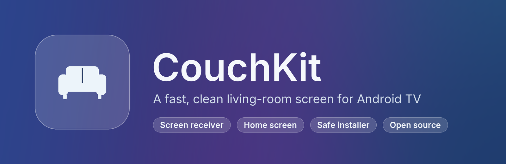
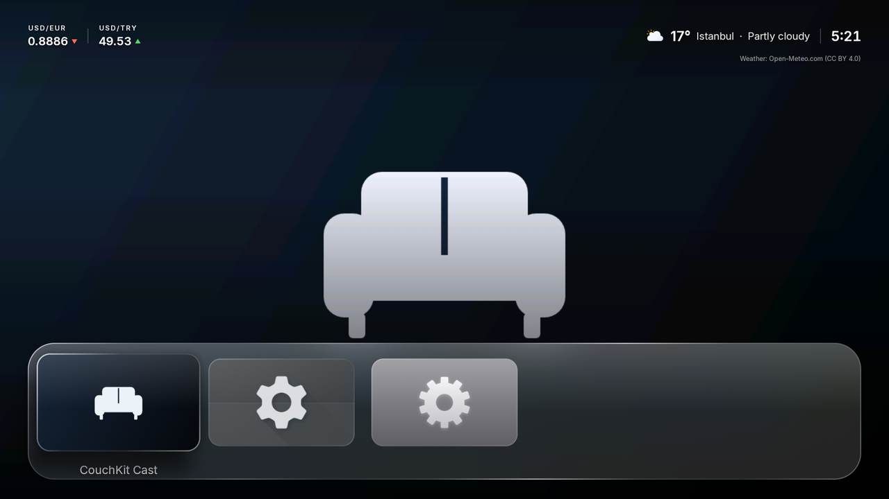
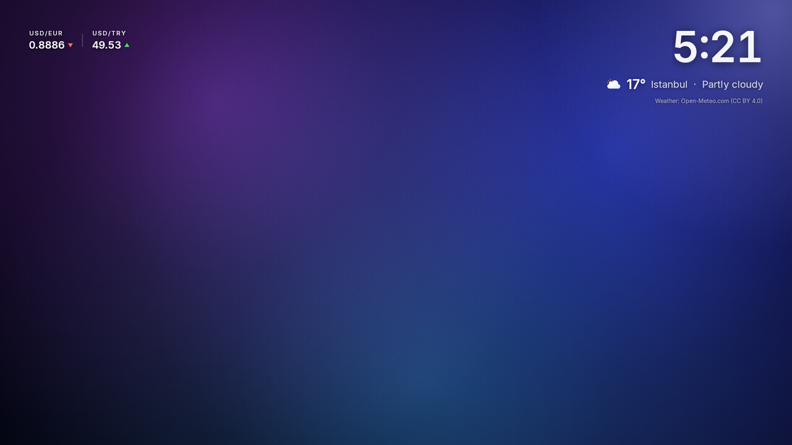
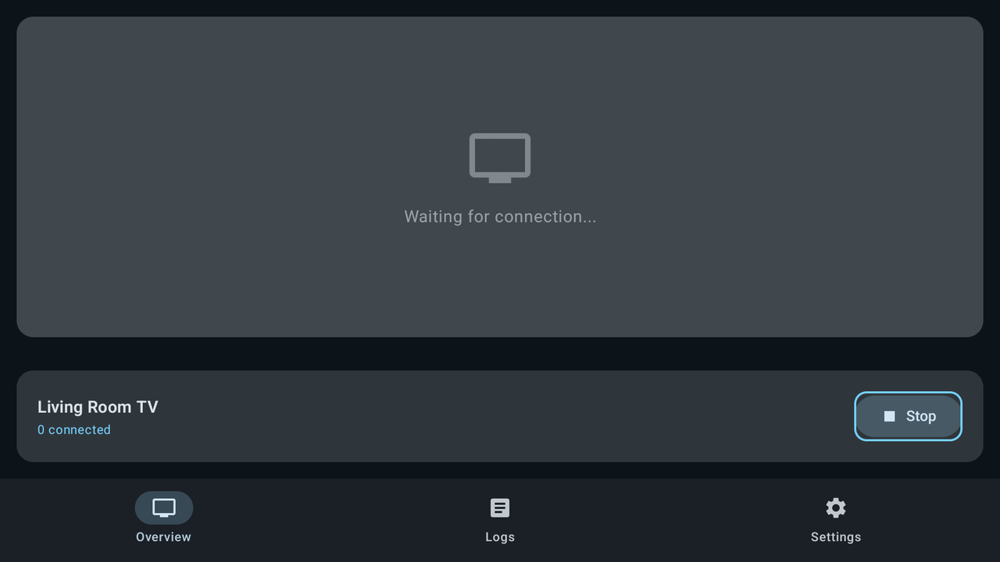
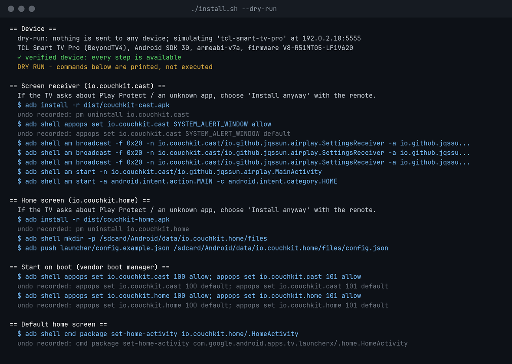

<p align="center"></p>

<p align="center">
  <a href="LICENSE"></a>
  <a href="receiver/LICENSE"></a>
  
  <a href="README.tr.md"></a>
</p>

**CouchKit turns a slow, ad-filled Android TV / Google TV into a fast, clean living-room screen.**
It has three parts, and you can install any of them on its own:

| | |
|---|---|
| 📺 **CouchKit Cast** | Mirror your iPhone, iPad or Mac to the TV. Works with AirPlay-compatible senders. It starts with the TV and comes to the front by itself when someone connects. |
| 🛋️ **CouchKit Home** | A light, glass-style home screen. Optional extras: weather, exchange rates, live match card, featured row and screensaver. |
| 🧰 **Installer** | One script that checks your TV and asks before every change. It verifies each change and can undo all of them. |

<table>
<tr>
<td width="50%"><br><sub><b>Home screen</b> with weather and exchange rates</sub></td>
<td width="50%"><br><sub><b>Screensaver</b>: your own photos and videos, or a moving gradient</sub></td>
</tr>
<tr>
<td width="50%"><br><sub><b>Receiver</b> waiting for a sender</sub></td>
<td width="50%"><br><sub><b>Installer</b> preview (<code>--dry-run</code>)</sub></td>
</tr>
</table>

## Quick start

> **New to this?** The **[step-by-step guide](docs/GUIDE.md)** walks you through everything with
> screenshots, from turning on developer options on the TV to the first screen mirroring session.
> Türkçe kılavuz: **[docs/KILAVUZ.md](docs/KILAVUZ.md)**.

1. On the TV, turn on **Developer options → USB debugging** and note the TV's IP address
   ([how](docs/GUIDE.md#1-turn-on-developer-options-on-the-tv)).
2. Install adb on your computer:
   - macOS: `brew install android-platform-tools`
   - Linux: `sudo apt install adb`
   - Windows: [guide](docs/GUIDE.md#4-install-adb-on-your-computer)
3. Download this repository. Put `couchkit-cast.apk` and `couchkit-home.apk` from **Releases**
   into `dist/`, or build them with `./scripts/build.sh`.
4. Preview, then install:
   ```bash
   ./install.sh --dry-run
   ./install.sh --host 192.168.1.23
   ```
   Accept *Allow USB debugging?* on the TV. If the TV shows *Play Protect*, choose *Install anyway*.

Undo at any time:

```bash
./install.sh --host 192.168.1.23 --undo     # reverts everything the script recorded
./install.sh --host 192.168.1.23 --rescue   # brings the stock home screen back
```

### Or let Claude do it

Open this folder in [Claude Code](https://claude.com/claude-code) and say *"install CouchKit on my
TV"*. Claude follows [CLAUDE.md](CLAUDE.md):
- it looks at the TV read-only first
- it explains which steps fit your device
- it runs the installer one step at a time, only after you approve each step

## Which TVs?

| Device | What you get |
|---|---|
| ✅ **Verified**: TCL Google TV "Smart TV Pro" (P735 series), Android 11, firmware `V8-R51MT05-LF1V620` | everything, including replacing the stock home screen (about 300 MB more free RAM) and debloat |
| 🟡 Other TCL Android / Google TVs | apps, the start-on-boot fix and the default home screen. Disabling packages needs `--allow-unverified`. |
| 🟢 Any other Android TV (Android 8+) | safe mode: apps, permissions and the default home screen. Nothing is disabled. |
| ⛔ Phones, tablets, non-TV devices | refused |

Tested on another model? Please share the result: [docs/DEVICES.md](docs/DEVICES.md).

## What the installer changes

| Step | Change on the TV | Undo |
|---|---|---|
| `receiver` | installs CouchKit Cast, allows it to come to the front, sets its name and start-on-boot | uninstall, permission reset |
| `launcher` | installs CouchKit Home and optionally your `config.json` | uninstall |
| `autostart` | TCL only: lets the vendor boot manager start both apps (`appops` 100/101). It runs only if the firmware names these ops `APP_AUTO_START` / `APP_ASSOC_START`. | ops back to default |
| `home` | makes CouchKit Home the default home screen | previous home restored |
| `homekey` | stock Google TV / Android TV launcher only: Home button service. It cannot read screen content. | previous setting restored |
| `replace-stock-home` *(opt-in)* | disables the stock launcher **and** the setup wizard together. It first checks CouchKit Home is the home app, then verifies Home still works. If not, it rolls back immediately. | both re-enabled |
| `debloat` *(opt-in)* | `pm disable-user` on the vendor telemetry and ad lists in [installer/debloat/](installer/debloat). Nothing is ever uninstalled. | `pm enable` each |
| `screensaver` *(opt-in)* | sets the CouchKit screensaver | previous screensaver restored |

**Why disable the launcher and the setup wizard together?** On the verified TV, disabling only the
stock launcher makes the setup wizard's recovery screen take over the Home button at the next boot.
The TV then looks frozen. The installer never disables one without the other.

## Home screen extras

Every extra is **off until you turn it on** in `config.json`, and the API keys are your own.
Copy [launcher/config.example.json](launcher/config.example.json), keep what you want and install
it with `--config`.

| Extra | Source | Key |
|---|---|---|
| Weather | [Open-Meteo](https://open-meteo.com) | none |
| Exchange rates | [Frankfurter](https://frankfurter.dev) (ECB reference rates) | none |
| Featured row (popular titles per streaming app) | [TMDB](https://www.themoviedb.org) | your free TMDB key |
| Live match card + goal alert | [API-Football](https://www.api-football.com) | your free key (100 requests/day) |
| Screensaver | your own photos/videos in `Android/data/io.couchkit.home/files/screensaver/` | none |

## Build from source

```bash
./scripts/build.sh                  # receiver uses upstream's unmodified native libraries
./scripts/build.sh --native-source  # build the receiver's native code from source as well
```

You need JDK 21 and the Android SDK (Android Studio includes both). Release signing uses your own
key ([receiver](receiver/README.md), [launcher](launcher/README.md)). This project never ships a
signing key.

## Legal

- **Licenses:**
  - `receiver/` is **GPL-3.0**. It is a modified
    [android-airplay-server](https://github.com/jqssun/android-airplay-server) (based on
    [UxPlay](https://github.com/FDH2/UxPlay)); changes are in [receiver/CHANGES.md](receiver/CHANGES.md).
  - Everything else is **Apache-2.0**.
  - Details: [NOTICE](NOTICE) and [THIRD_PARTY.md](THIRD_PARTY.md).
- **Not affiliated:** CouchKit is not affiliated with Apple, Google, TCL or any streaming service.
  Product names are used only to describe compatibility ([TRADEMARKS.md](TRADEMARKS.md)). Protected
  (DRM) content cannot be mirrored.
- **No warranty:** the software changes system settings of your TV. Read [DISCLAIMER.md](DISCLAIMER.md).

## Contributing

Run `./scripts/secret-scan.sh` before every commit. Follow [TRADEMARKS.md](TRADEMARKS.md):
- no third-party logos, fonts, wallpapers or videos
- no brand names in app or package names
