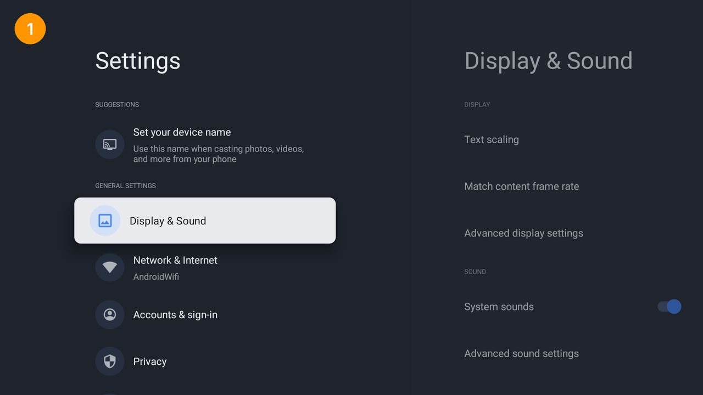
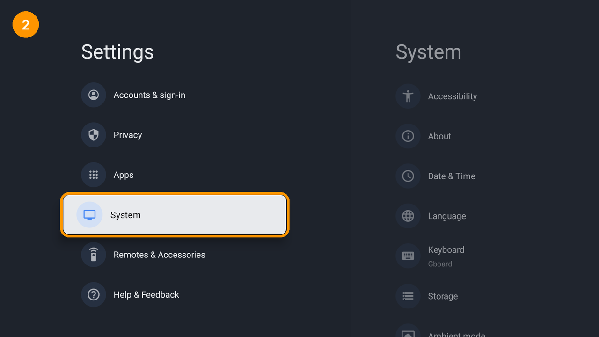
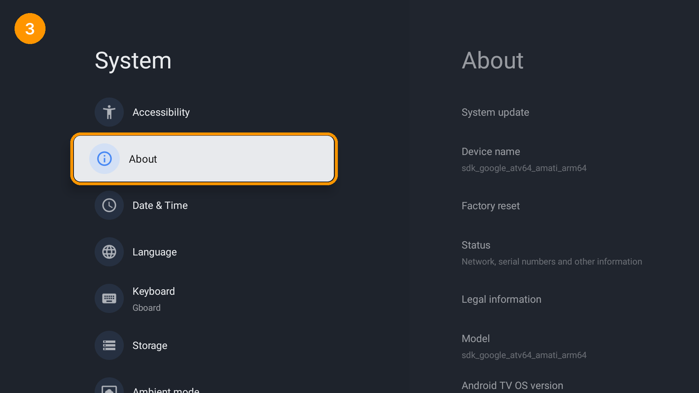
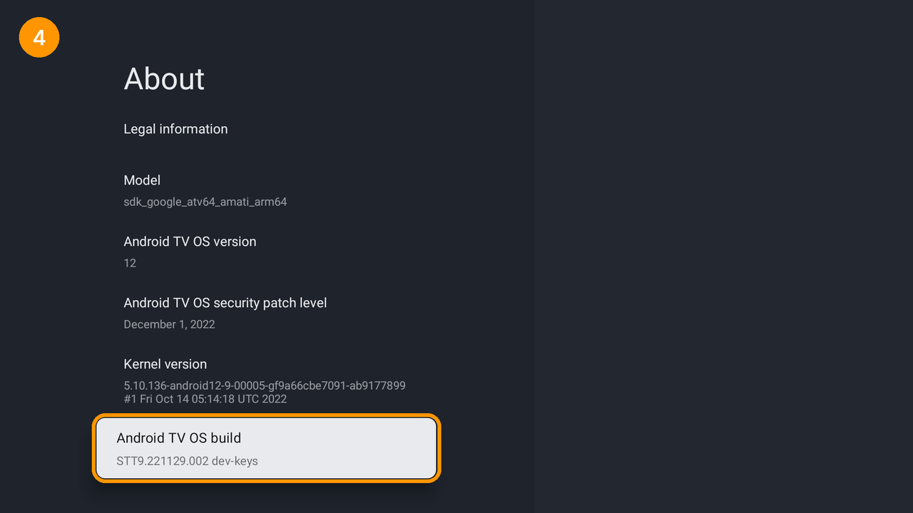
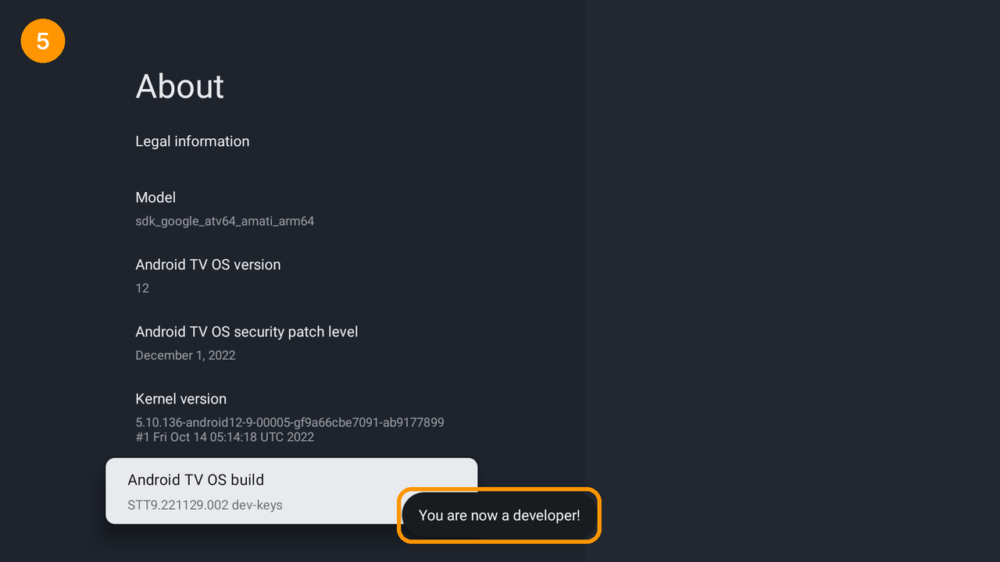
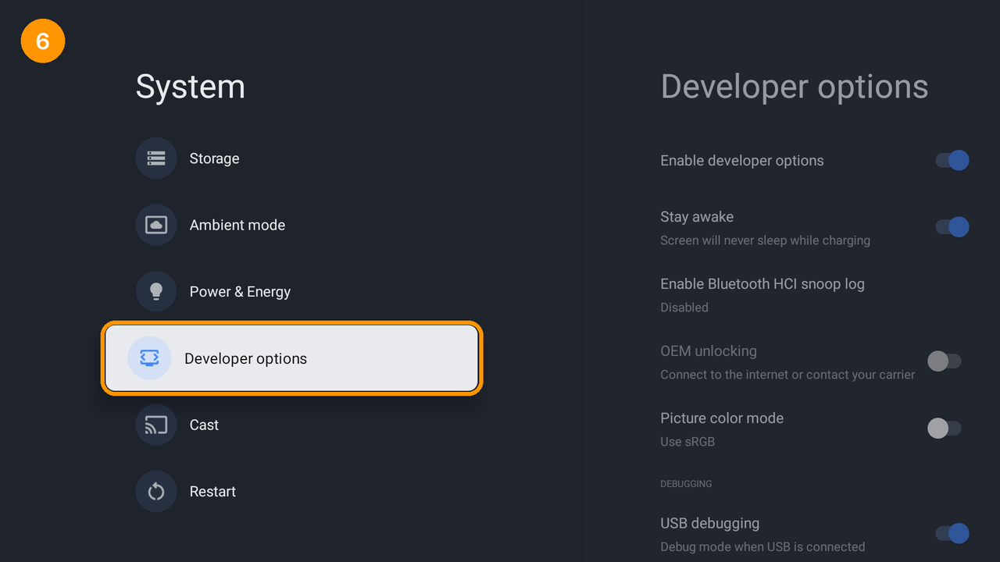
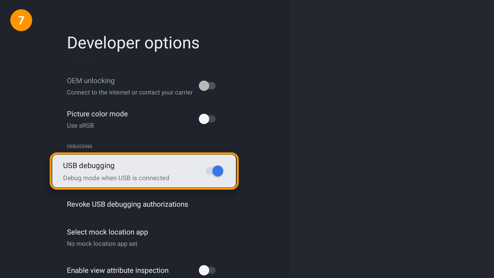
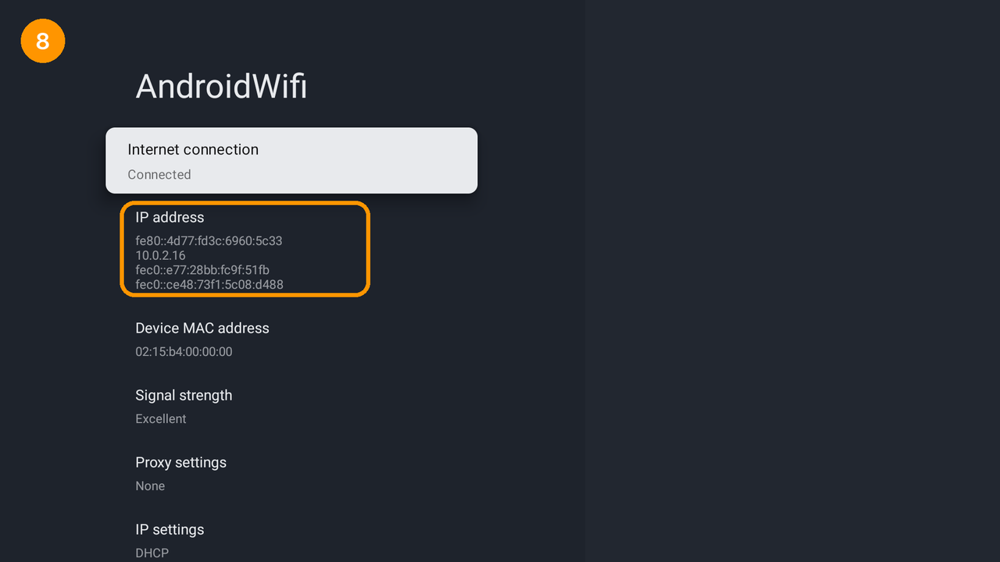
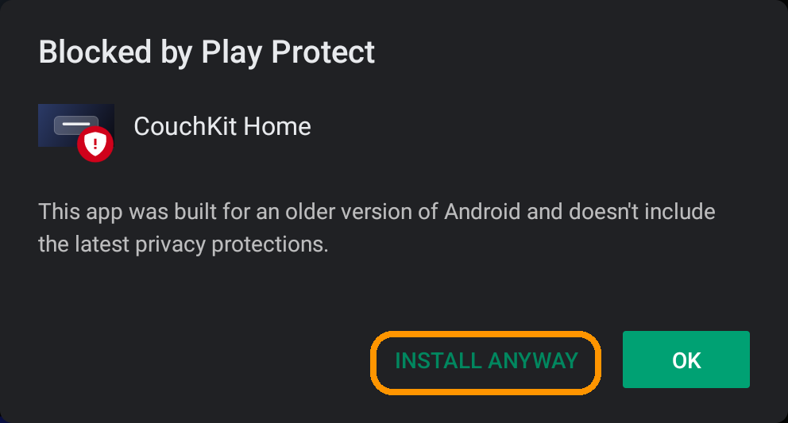

# Adım adım kurulum kılavuzu

Bu kılavuz hiç adb kullanmamış biri için yazıldı. Yaklaşık 15 dakika sürer. Bilgisayarınız ile
TV'niz **aynı ağda** (aynı modeme bağlı) olmalı.

> Ekran görüntüleri bir Google TV'den alındı. Menü adları markaya göre biraz değişebilir. Örneğin
> eski Android TV'lerde "Sistem" yerine "Cihaz Tercihleri" yazar. Mantık aynıdır.

İçindekiler:
1. [TV'de Geliştirici seçeneklerini açın](#1-tvde-geliştirici-seçeneklerini-açın)
2. [USB hata ayıklamayı açın](#2-usb-hata-ayıklamayı-açın)
3. [TV'nin IP adresini bulun](#3-tvnin-ip-adresini-bulun)
4. [Bilgisayara adb kurun](#4-bilgisayara-adb-kurun)
5. [CouchKit'i indirin](#5-couchkiti-indirin)
6. [TV'ye bağlanın](#6-tvye-bağlanın)
7. [Kurun](#7-kurun)
8. [Kullanın](#8-kullanın)
9. [Geri alma ve sorun giderme](#9-geri-alma-ve-sorun-giderme)

---

## 1. TV'de Geliştirici seçeneklerini açın

Kumandayla **Ayarlar**'ı açın. Google TV'de sağ üstteki dişli simgesi → *Tüm ayarlar*.



**Sistem**'e girin.



**Hakkında**'ya girin.



En alta inip **Android TV OS yapısı** (ya da "Yapı numarası" / "Build") satırına gelin.



Bu satırın üzerindeyken kumandanın **OK** tuşuna arka arkaya **7 kez** basın. Ekranda
*"Artık bir geliştiricisiniz!"* yazısı çıkar. TV PIN soruyorsa girin.



## 2. USB hata ayıklamayı açın

**Geri** tuşuyla Sistem menüsüne dönün. Listenin altında artık **Geliştirici seçenekleri** var;
oraya girin.



**Hata ayıklama** başlığının altındaki **USB hata ayıklama**'yı açın. Uyarıya *Tamam* deyin.



> **Kablo gerekmez.** Adında "USB" geçse de çoğu Android TV bu ayar açıkken ağ üzerinden de
> bağlantı kabul eder (port 5555). Listede **Ağ üzerinden hata ayıklama**, **ADB over network**
> ya da **Kablosuz hata ayıklama** varsa onu da açın. "Kablosuz hata ayıklama"nın ne yaptığı
> 6. adımda anlatılıyor.

## 3. TV'nin IP adresini bulun

**Ayarlar → Ağ ve İnternet** bölümüne girip bağlı olduğunuz ağı seçin. **IP adresi** satırındaki
`192.168.` ya da `10.` ile başlayan dört parçalı sayıyı (örneğin `192.168.1.23`) bir yere not edin.



> İpucu: Modeminizin ayarlarından TV'ye "sabit IP / DHCP rezervasyonu" verirseniz bu adres hiç değişmez.

## 4. Bilgisayara adb kurun

adb, Google'ın ücretsiz "Android Platform Tools" paketindeki komut satırı aracıdır.

**macOS**
1. **Terminal**'i açın: Spotlight'ta (⌘ + Boşluk) "Terminal" yazın.
2. [Homebrew](https://brew.sh) kurulu değilse sitedeki tek satırlık komutla kurun.
3. Sonra şunu çalıştırın:
   ```bash
   brew install android-platform-tools
   ```

**Windows**
1. [Git for Windows](https://git-scm.com/download/win)'u kurun. Yanında **Git Bash** gelir; CouchKit
   betiği bu pencerede çalışır.
2. [SDK Platform Tools](https://developer.android.com/tools/releases/platform-tools) zip'ini indirip
   `C:\platform-tools` klasörüne açın.
3. Git Bash'te şunu çalıştırın (bu oturum için yeterli):
   ```bash
   export PATH="$PATH:/c/platform-tools"
   ```

**Linux (Debian/Ubuntu)**
```bash
sudo apt install adb
```

Kontrol: aşağıdaki komut bir sürüm numarası yazdırmalı.
```bash
adb version
```

## 5. CouchKit'i indirin

1. Bu sayfanın üstündeki yeşil **Code** düğmesi → **Download ZIP**'e tıklayın ve zip'i açın.
   Git biliyorsanız `git clone` da olur.
2. Terminali bu klasörde açın:
   - macOS: Finder'da klasöre sağ tıklayın → *Klasörde Yeni Terminal*.
   - Windows: klasörde sağ tıklayın → *Open Git Bash here*.
3. Uygulama dosyalarını (APK) edinin. İki yol var:
   - **Kolay:** sayfanın sağındaki **Releases** bölümünden `couchkit-cast.apk` ve
     `couchkit-home.apk` dosyalarını indirip CouchKit klasöründeki `dist/` klasörüne koyun.
   - **Kendiniz derleyin:** JDK 21 ve Android SDK gerekir. Android Studio kuruluysa ikisi de vardır.
     ```bash
     ./scripts/build.sh
     ```

## 6. TV'ye bağlanın

```bash
adb connect 192.168.1.23
```

(IP yerine kendi TV'nizin adresini yazın.) TV'de **"USB hata ayıklamaya izin verilsin mi?"**
penceresi çıkar. **Bu bilgisayardan her zaman izin ver** kutusunu işaretleyip **Tamam**'a basın.
Ardından şunu çalıştırın:

```bash
adb devices
```

Listede `192.168.1.23:5555  device` görmelisiniz. `unauthorized` yazıyorsa TV'deki pencereyi
onaylamadınız demektir.

> **Kablosuz hata ayıklama (Android 11 ve üstü bazı TV'ler):** TV'de *Kablosuz hata ayıklama →
> Eşleştirme koduyla cihaz eşle* deyin. Ekranda IP:port ve 6 haneli bir kod çıkar.
> 1. Eşleştirin:
>    ```bash
>    adb pair 192.168.1.23:37123
>    ```
>    (kodu girin)
> 2. Bağlanın: `adb connect` komutunu, Kablosuz hata ayıklama ekranında yazan **diğer** IP:port ile
>    çalıştırın.
> 3. Kurulumda da aynı adresi kullanın: `--host 192.168.1.23:4xxxx`.

## 7. Kurun

Önce ne yapılacağını görün. Bu komut hiçbir şey değiştirmez ve TV'ye bağlanmaz:
```bash
./install.sh --dry-run
```

Sonra kurun:
```bash
./install.sh --host 192.168.1.23
```

Betik önce TV'yi tanır: marka, model, Android sürümü. Ardından her değişiklikten önce
`[y/N]` diye sorar. `y` yazıp Enter'a basın. Her adımdan sonra doğrulama yapar (✓).

Kurulum sırasında TV'de **Play Protect** uyarısı çıkarsa kumandayla **Yine de yükle**'yi seçin.
Uygulamalar Play Store'dan gelmediği için bu uyarı normaldir.



Neler kurulur:

| Adım | Ne olur |
|---|---|
| receiver | CouchKit Cast kurulur. TV açılınca kendiliğinden başlar, biri bağlanınca öne gelir. |
| launcher | CouchKit Home kurulur. |
| autostart | Yalnız TCL: üreticinin açılış yöneticisi uygulamaların başlamasına izin verir. |
| home | CouchKit Home varsayılan ana ekran olur. |
| homekey | Kumandanın Ev tuşu CouchKit Home'u açar. Bu bir erişilebilirlik servisidir ama ekran içeriğini okuyamaz. |

İsteğe bağlı olanlar:

```bash
./install.sh --host 192.168.1.23 --name "Salon TV"            # yansıtma listesinde görünen ad
./install.sh --host 192.168.1.23 --only launcher --config ayarlarim.json   # hava, döviz, maç...
./install.sh --host 192.168.1.23 --screensaver                # CouchKit ekran koruyucusu
./install.sh --host 192.168.1.23 --replace-stock-home         # stok ana ekranı kapat (~300 MB RAM)
./install.sh --host 192.168.1.23 --debloat=safe               # üretici reklam/telemetri paketleri
```

`--replace-stock-home` ve `--debloat` yalnızca **doğrulanmış** cihazlarda çalışır
([installer/verified-devices.txt](../installer/verified-devices.txt)).

`ayarlarim.json` için [launcher/config.example.json](../launcher/config.example.json) dosyasını
kopyalayın. Kullanmadığınız bölümleri silin; anahtarlar sizin kendi ücretsiz hesaplarınızdır:
- **Öne çıkanlar şeridi:** [TMDB](https://www.themoviedb.org/settings/api)
- **Maç kartı:** [API-Football](https://dashboard.api-football.com/register)

## 8. Kullanın

- **Ana ekran:** Ev tuşuna basın. Yön tuşlarıyla gezinin.
  - **OK**: uygulamayı açar.
  - **OK'a basılı tutmak**: taşıma modunu açar.
  - Taşıma modunda **OK'a tekrar basılı tutmak**: uygulamayı gizler.
- **Ekran yansıtma:**
  - iPhone/iPad: Denetim Merkezi → **Ekran Yansıtma** → listeden TV'nizin adını seçin (varsayılan
    "Living Room TV" ya da `--name` ile verdiğiniz ad).
  - Mac: Menü çubuğu → Denetim Merkezi → **Ekran Yansıtma**.
  - Ses ve video için uygulamaların içindeki yansıtma simgesini kullanın.
- Yansıtma bitince TV kendiliğinden önceki ekrana döner.


## 9. Geri alma ve sorun giderme

```bash
./install.sh --host 192.168.1.23 --status   # durum (hiçbir şey değiştirmez)
./install.sh --host 192.168.1.23 --undo     # bu betiğin yaptığı her şeyi geri alır
./install.sh --host 192.168.1.23 --rescue   # stok ana ekranı geri getirir (kayıt olmasa da)
```

| Sorun | Çözüm |
|---|---|
| `adb connect` → *connection refused* | 2. adımdaki ağ üzerinden / kablosuz hata ayıklamayı açın. TV ile bilgisayar aynı ağda mı? |
| `unauthorized` | Geliştirici seçenekleri → *USB hata ayıklama yetkilerini iptal et*, ardından USB hata ayıklamayı kapatıp açın ve tekrar bağlanın. |
| Kurulum takılı kaldı | TV'de Play Protect penceresi açık olabilir. *Yine de yükle*'yi seçin. |
| TV yansıtma listesinde yok | TV ile telefon aynı ağda mı? TV'de CouchKit Cast'i bir kez açın. Misafir ağı ve VLAN cihazları birbirinden gizler. |
| Ev tuşu hâlâ eski ana ekranı açıyor | `./install.sh --host IP --only homekey` |
| Yeniden başlatmadan sonra siyah ekran / kurtarma ekranı | `./install.sh --host IP --rescue` |
| Hiçbiri olmadı | TV ayarlarından fabrika ayarlarına dönmek her şeyi sıfırlar (TV'deki veriler silinir). |

Takıldığınız yeri, `--status` çıktısıyla birlikte bir GitHub *Issue* olarak yazabilirsiniz. IP
adresinizi ve hesap adlarınızı silmeyi unutmayın.
